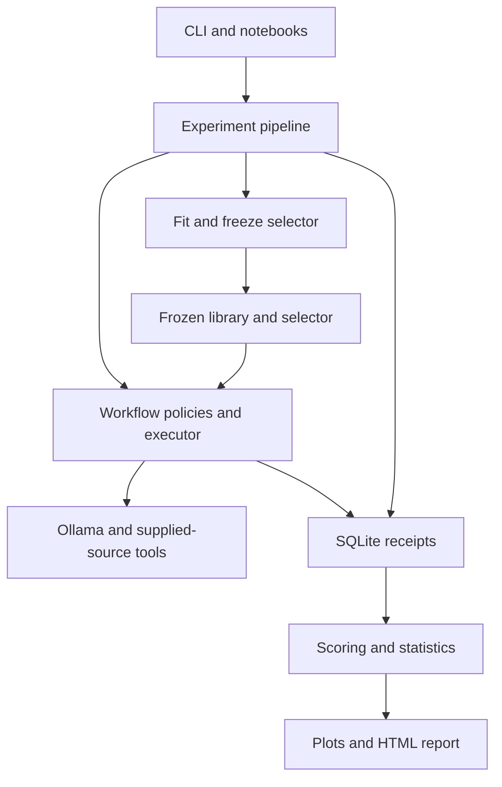

# Project architecture and implementation plan

**Project:** Task-Adaptive Multi-Agent Reasoning: Workflow Reuse for Reliable and Efficient Problem Solving  
**Author:** Angelo Ottendorfer  
**Design baseline:** 14 October 2026  
**Repository and Python package:** `workflow-reuse-orchestrator` / `workflow_reuse_orchestrator`

This document defines the fixed structure for the new workflow-reuse repository. It replaces the earlier file-level roadmap as the main planning reference. The previous allocation repository remains archived as a source of reusable engineering components; it is not an active implementation path.

The predecessor reviewed for reusable engineering components is the repository uploaded as `complexity-aware-orchestrator(20261013-084800).zip` and the latest proposal, `Proposal-Task-Adaptive Multi-Agent Reasoning(1).docx`. The older planning PDF and allocation implementation provide background and reusable engineering components. The latest proposal defines the active research scope.

The first commit implements the package/version, CLI, configuration loader, and offline `pipeline check`/`pipeline plan` commands. The 44-module structure and nine notebook outlines are present. Workflow execution, runtime verification, storage, training, plots, and scientific evaluation remain pending. APIs labeled as targets below are future work.

## 1. Fixed decisions

The project will be one local Python research application, with one execution pipeline and a notebook sequence that explains and visualizes that pipeline.

| Decision | Fixed baseline |
| --- | --- |
| Research problem | Select and reuse collaborations for supplied-document question answering. |
| Datasets | HotpotQA distractor, DROP, and FinQA. |
| Generative model | One bound pretrained model shared by agents, planning, generalization, baselines, and transfer experiments. Final identity and decoding controls follow representative development pilots. |
| Text representations | One separate frozen text encoder with an immutable revision. |
| Agent roles | Coordinator, retrieval, reasoning, and checking. |
| Workflow representation | Validated directed acyclic graphs, at most 12 nodes per graph. |
| Principal methods | Single agent, fixed workflow, per-question planning, similarity reuse, and MLP prediction reuse. |
| Success predictors | Logistic regression, gradient-boosted trees, and an MLP with exactly two hidden layers. |
| Main feature contract | 140 pre-execution features, with the proposal's five feature groups. |
| Execution | One executor and one cumulative budget per request, including planning, attempted reuse, repair, and fallback. |
| Development and final evaluation | Explicitly separate source groups and frozen final releases. |
| User entry points | The existing `orchestrator` CLI and nine numbered notebooks. |
| Results | SQLite receipts, a compact HTML report, and a metrics CSV. |
| Deployment scope | A local reproducible prototype and an inspectable report. |

The new repository and package use workflow-reuse names. A web service, a general agent framework, and a separate model-routing subsystem are outside the baseline. Python, uv, Ollama, SQLite, Pydantic, NumPy, pandas, scikit-learn, and notebook plotting tools cover the planned scope. The starter installs only configuration and development dependencies; add other dependencies when their work package requires them.

## 2. What the predecessor repository tells us

The archived predecessor upload contains **141 source Python files, 30,008 source lines, 96 test Python files, and two notebooks**. Source-line counts include comments and blank lines; notebook counts below include code cells only.

| Current area | Files / lines | Assessment |
| --- | ---: | --- |
| `learning/` | 29 / 13,105 | Mixes dataset preparation, allocation prediction, continuation policies, risk analysis, calibration, and artifacts. Most of its research objectives belong to the earlier allocation study. |
| `benchmarking/` | 22 / 6,993 | Contains useful storage, progress, and reproducibility foundations alongside allocation-specific experiment orchestration. |
| `domain/`, `execution/`, and runtime helpers | Distributed across several packages | Provider contracts, accounting, calculator execution, and record integrity can be adapted for workflow execution. |
| `notebooks/data_engineering.ipynb` | 3,505 code lines | Contains its own ingestion, transformation, and grouping implementation. |
| `notebooks/allocation_analysis.ipynb` | 2,254 code lines | Contains its own estimators, calibration, policy replay, and artifact implementation. |

Neither predecessor notebook imports its project package. Their roughly 5,800 combined code lines therefore add another implementation path to maintain.

The predecessor upload also contains two successful runtime-check receipts for `qwen3:4b-instruct-2507-q4_K_M`. Its workflow configuration has a real model binding and a 4,096-token context, 128-token output cap, and one-call request allowance. **The predecessor model infrastructure check passed on its recorded machine.** The new repository must revalidate the binding after the provider adapter is migrated. These allowances are for the short development check; they still need replacement with measured workflow allowances. Encoder and agent-prompt bindings remain pending.

The central simplification is to establish one active workflow study and move notebook algorithms into the application. Reducing file count follows from removing obsolete objectives and duplicated implementations, rather than combining unrelated code into very large files.

## 3. Fixed repository layout

### 3.1 Top-level ownership

| Path | Purpose |
| --- | --- |
| `src/workflow_reuse_orchestrator/` | Production and research implementation used by both CLI and notebooks. |
| `tests/` | Contract, unit, integration, and small end-to-end tests. |
| `notebooks/` | Nine sequential research narratives using package functions and persisted artifacts. |
| `configs/` | Four active YAML configurations and versioned prompts. |
| `docs/` | Architecture/roadmap and operating instructions. |
| `data/raw/` | Acquired source releases with original bytes and provenance. |
| `data/processed/<snapshot_id>/` | A versioned canonical dataset database and its preparation manifest. |
| `data/cache/` | Recomputable frozen-encoder representations and related indexes. |
| `runs/<run_id>/` | Results, progress, and compact reports for one development or final run. |
| `artifacts/` | Explicit exports of frozen deployment/reproduction bundles. |
| `examples/` | A few reference-free document questions for a small demonstration. |

Generated datasets, model artifacts, caches, and run databases stay outside Git. Notebook source and reviewed figures intended for the thesis remain versioned. Optional figure exports are deliberate publication outputs, rather than an extra directory created by every stage.

### 3.2 Eight source areas

| Area | Responsibility | Planned modules, excluding `__init__.py` |
| --- | --- | --- |
| `domain/` | Pure typed inputs, graphs, outcomes, budgets, and provider contracts. | `tasks.py`, `workflows.py`, `outcomes.py`, `budgets.py`, `providers.py` |
| `data/` | Acquire and normalize the three datasets; preserve sources/tables; assign scientific partitions. | `prepare.py`, `hotpotqa.py`, `drop.py`, `finqa.py`, `splits.py` |
| `runtime/` | Ollama, the frozen encoder, supplied-source tools, and cumulative budget enforcement. | `ollama.py`, `encoder.py`, `tools.py`, `budgets.py` |
| `workflows/` | Role instructions, planning, graph execution, reusable library construction, and method policies. | `agents.py`, `planning.py`, `execution.py`, `library.py`, `policies.py` |
| `learning/` | Candidate-success examples, shared features/transforms, predictor training, and online selection. | `examples.py`, `features.py`, `training.py`, `selection.py` |
| `evaluation/` | Dataset answer scoring and registered statistical comparisons. | `scoring.py`, `statistics.py` |
| `experiments/` | Named pipeline stages, experiment families, resumable scheduling, and frozen releases. | `pipeline.py`, `stages.py`, `definitions.py`, `freeze.py` |
| `reporting/` | Result queries, plots, trace inspection, and the HTML report. | `queries.py`, `plots.py`, `report.py`, `templates/report.html` |

The package root contains `__init__.py`, `cli.py`, `config.py`, and `storage.py`:

- `cli.py` parses arguments and calls the pipeline. It contains no learning or experiment algorithms.
- `config.py` loads validated settings, resolves project paths, and exposes the resolved values. The experiment pipeline assembles explicitly configured components.
- `storage.py` owns common transactional persistence, checksums, receipts, and read-only database access. Keeping it outside `experiments/` avoids a reporting-to-experiment-orchestration dependency.

This enumerates **44 Python files including package initializers**, plus the HTML template. The starter includes these files as an overview; most remain empty. Implement modules when their work package needs them. A justified new module can be added through an update to this document; file count alone is not an acceptance criterion.

Selectively adapted predecessor helpers may remain separate temporarily during migration. Related behavior should share a module; new wrapper packages, generic service layers, and one-function files require a concrete benefit.

### 3.3 Dependency rules

| Component | Dependencies it may use |
| --- | --- |
| `domain` | Python and Pydantic; no other project area. |
| `config`, `storage` | Domain contracts and infrastructure libraries; no workflow fitting or experiment scheduling. |
| `data` | Domain/configuration/storage; dataset integrations loaded when acquisition is requested. |
| `runtime` | Domain/configuration; optional encoder integration loaded when encoding is requested. |
| `workflows` | Domain/runtime contracts and supplied components; no gold scorer or model fitting. |
| `learning` | Domain/runtime/storage for representation, recorded examples, training, and frozen prediction. |
| `evaluation` | Domain and read-only scoring inputs; no agent execution or fitting. |
| `reporting` | Storage, evaluation summaries, and plotting; no generation or fitting. |
| `experiments` | Coordinates the above areas and owns stage order and scientific scope. |
| `cli` / notebooks | Call public configuration, stage, query, and plotting functions. |

`learning/selection.py` applies frozen transformations and predictors. It does not import training orchestration or call `fit`. Optional ML imports can load when a trained selector is actually requested. A small required set of provider/encoder/tool contracts is sufficient; these interfaces live alongside the domain contracts rather than in an additional hierarchy.



The diagram describes the target system. Fitting belongs to development; protected execution loads already-frozen assets.

## 4. Core contracts and runtime behavior

### 4.1 Contracts worth keeping explicit

| Contract | Contents / boundary |
| --- | --- |
| `TaskInput` | Stable question identity, question, supplied passages/tables, source locations, and observable input metadata. No reference answer or gold annotations. |
| `EvaluationReference` | Answer forms and evaluator-only support/program annotations. Joined only after execution or for permitted development labeling. |
| `Workflow` / `WorkflowNode` | Version, stable graph identity, role, reusable instructions, dependencies, input/output bindings, and final-answer designation. |
| `AgentOutput` | Structured answer/evidence/tool request/checker verdict appropriate to the role. |
| `RequestBudget` / `ResourceUsage` | Call, input-token, output-token, tool-call, wall-time, and repair allowances; measured cumulative usage and availability flags. |
| `SelectionDecision` | Common candidate identities, similarities, success probabilities where applicable, estimated token costs, qualification/rejection reasons, and chosen workflow. |
| `ExecutionTrace` | Run/request/attempt/node identities, ordered events, inputs/outputs, source references, available timings/tokens, and failure reasons. |
| `FrozenRelease` | Library, encoder, transforms, predictor, calibration, thresholds, prompts/tools, protocol, and data/code/environment lineage. |

These are ordinary typed data structures. A generated workflow describes a procedure; it is never an arbitrary Python program.

### 4.2 Roles and shared tools

| Role | Behavior |
| --- | --- |
| Coordinator | Plans a bounded graph, manages candidate selection, and invokes bounded fallback. Candidate retrieval/prediction itself runs in host code. |
| Retrieval | Finds evidence only in the current question's supplied passages and tables, with stable paragraph/sentence/cell references. |
| Reasoning | Combines returned evidence, compares values, and submits typed arithmetic expressions to the calculator where needed. |
| Checking | Checks evidence and intermediate outputs; returns pass/fail/uncertain under a declared rule. It has no reference-answer access. |

Use one parameterized role executor with role-specific prompts and output contracts. The runtime tools provide supplied-source search and restricted arithmetic; graph-library retrieval is a separate library operation. The single-agent baseline receives the same permitted evidence and tools with a bounded tool loop. One agent can make multiple calls.

The five prompt files are `coordinator.md`, `retrieval.md`, `reasoning.md`, `checking.md`, and `generalization.md`. Generalization is an offline coordinator function, not a fifth agent role. All five use the same bound generative model.

| Principal policy | Planning and recovery definition |
| --- | --- |
| Single agent | One role with a bounded evidence/calculator loop; no collaboration-graph planner. |
| Fixed workflow | One development-selected graph; no task-specific replanning. |
| Per-question planning | One newly planned graph per question, with the declared malformed-plan repair limit; all planning costs count. |
| Similarity reuse | Common candidate retrieval and a frozen similarity rule; rejected/failed reuse permits one newly planned fallback. |
| MLP prediction reuse | The same candidates and fallback, selected using qualified success predictions and estimated token cost. |

Confirmed runtime failure produces an explicit failed delivery unless the policy's declared recovery permits continuation. Fixed-workflow and single-agent execution do not silently invoke a multi-agent planner. All policies share the model, supplied evidence, relevant permitted tools, output/scoring contract, and whole-request ceilings; the differences in planning and reuse are the treatment being measured.

### 4.3 One execution path

Every method invokes the same graph/agent runtime. Execute nodes in a deterministic topological order, pass declared predecessor outputs, validate structured outputs, and record every attempted effect. Independent nodes initially execute sequentially to make accounting and experiments easier to interpret.

Learned reuse follows this sequence:

1. Encode the current input and retrieve up to three eligible library workflows.
2. Build the same pre-execution features used in fitting.
3. Predict candidate success; apply the frozen threshold.
4. Select the qualified workflow with the lowest estimated token use, using stable identity for ties.
5. Execute it using fresh evidence and the remaining shared budget.
6. If no candidate qualifies, or the declared execution/checking rule detects failure, permit at most one fresh fallback plan under that same budget.
7. Return the final outcome and complete attempt accounting; the offline scorer then evaluates correctness.

Similarity reuse shares candidates, permissions, and fallback. Gold correctness never triggers fallback. Planning repairs, failed reuse, and fallback consume the original request allowance. The 12-node limit applies to each graph; cumulative calls and tokens also constrain the whole request.

## 5. Data preparation and scientific separation

Acquire full released sources independently of the number of tasks ultimately executed. Preserve original passages, sentence boundaries, FinQA tables/cells, source identifiers, raw split names, acquisition metadata, and content hashes.

| Dataset | Planned final pool from proposal | Primary / supplementary scoring |
| --- | ---: | --- |
| HotpotQA public development, distractor | 7,405 | Verified official answer exact match / answer F1. |
| DROP public development | 9,536 | Verified official answer exact match / answer F1, preserving answer types. |
| FinQA public test | 1,147 | Numerical answer accuracy under documented normalization and tolerance. |
| Total | 18,088 | Planned unfiltered population; actual retained counts remain to be verified. |

Store prepared inputs, references, source relations, and partition assignments in `data/processed/<snapshot_id>/datasets.sqlite3`, with a small manifest. Raw sources remain separate. This is a dataset snapshot; `runs/<run_id>/results.sqlite3` stores execution outcomes and derived research artifacts.

The online-facing loader returns `TaskInput` only. References and gold programs live in separate evaluator tables and are not included in prompts or selector features. Tests enforce this boundary even though offline preparation can access both tables.

Use connected source groups for discovery construction, independent library validation, selector fitting, selector validation, selector calibration, and final evaluation. Threshold tuning can share an explicitly declared development-validation role or use a separate group-aware partition; it cannot silently use fitting or final data.

Audit cross-dataset overlap and group sizes before committing partition sizes. In particular, check whether common HotpotQA distractor articles create very large connected components. Document the feasibility of the source rule before expensive collection; silently splitting connected groups would invalidate the intended separation.

Notebook EDA uses development data by default. Final release identities and planned counts can be recorded for preparation; final outcomes are opened for results analysis after freezing. Final labels do not guide library admission, features, model choices, or thresholds.

Scorer behavior and binary-success definitions must be frozen **before candidate labeling**. Context handling must be explicit: no silent loss of table rows or long passages. Pin any selection, chunking, serialization, and encoder pooling rules and use them consistently across methods.

## 6. Success prediction and experiment scope

### 6.1 Shared feature contract

| Feature group | Count | Definition |
| --- | ---: | --- |
| Task representation | 64 | Fitting-only reduction of frozen question/context representations. |
| Workflow representation | 64 | Fitting-only reduction of frozen reusable graph/instruction representations. |
| Task metadata | 4 | Context length, source count, table-cell count, numerical-value count. |
| Workflow metadata | 6 | Agent steps, dependency depth, retrievals, reasoning steps, checks, handoffs. |
| Compatibility | 2 | Question–workflow similarity and question–context similarity. |
| Total | 140 | Fixed ordering and versioned definitions. |

Exclude dataset identity, gold annotations, answers, and observed current-task execution cost from predictors. Token estimates used to choose a workflow are separate development-derived estimates, not current-task cost observations.

Fit reduction/scaling only on fitting groups. A small workflow library may have fewer than 64 independent representations. Use a recorded fitting-only rank limit and a declared padding rule to preserve the 140-column interface; report effective rank. Held-out vectors cannot be added to make PCA fit. Define counts/handoffs and representation serialization once in the feature schema. Implementation should follow the estimator constraints in [PCA](https://scikit-learn.org/stable/modules/generated/sklearn.decomposition.PCA.html) and the fitting separation described in [scikit-learn's data-leakage guidance](https://scikit-learn.org/stable/common_pitfalls.html#data-leakage).

### 6.2 Predictor implementation

Use the existing scikit-learn stack for `LogisticRegression`, `HistGradientBoostingClassifier`, and `MLPClassifier` with a two-element hidden-layer tuple. Save the complete transformation/predictor/calibration state with its release. This keeps predictor fitting, probability estimation, and evaluation within one library. The relevant API contracts are documented in [MLPClassifier](https://scikit-learn.org/stable/modules/generated/sklearn.neural_network.MLPClassifier.html) and [HistGradientBoostingClassifier](https://scikit-learn.org/stable/modules/generated/sklearn.ensemble.HistGradientBoostingClassifier.html).

The MLP's two-layer shape is fixed; widths, regularization, iteration limits, and other controls use a bounded development search. Begin with finite iteration budgets and source-grouped external validation. Estimator defaults that create an internal random validation split must not undermine source grouping. Learning-curve figures should distinguish training loss from externally measured development performance.

Confirmed incorrect answers and execution/output failures are negative labels; correct answers under the frozen scorer are positive. Retain all-zero candidate sets. Interrupted observations with unknown outcomes remain missing/unknown rather than invented labels. Audits report class support, group counts, effective rank, missing labels, and missing telemetry before fitting.

The five principal live methods remain the proposal's baselines and MLP treatment. LR and GBT are required predictor comparisons; additional complete-policy executions are a registered supplementary budget decision. Feature ablations refit and retune the MLP without 6 workflow metadata features, without 4 task metadata features, and without both: 134, 136, and 130 input columns respectively. These ablations remove explicit metadata; embeddings may still contain related information.

### 6.3 Required experiment families

| Family | Required control and result |
| --- | --- |
| Principal comparison | Paired final questions for all five policies; dataset correctness, calls, tokens, live end-to-end time, and reuse/fallback outcomes. |
| Predictor comparison | LR/GBT/MLP on identical recorded candidate examples and features; MCC, Brier score, calibration, and fit time. |
| Feature ablation | Refitted variants; same library, candidate retrieval, tasks, and execution permissions. |
| Transfer | Three independently developed releases excluding HotpotQA, DROP, or FinQA from discovery through threshold/cost tuning. |
| Volume | Predeclared distinct request sequences; method-specific startup plus request costs. |
| Variability | Three executions on a subset fixed before final outcomes are inspected. |
| Human assessment | Two independent assessors on a blinded registered sample; agreement/kappa before reconciliation. |
| Candidate diagnostics | A predeclared final subset for additional candidate-success measurements, with costs disclosed separately. |

Report source-group bootstrap confidence intervals, registered paired tests, effect sizes, and Holm adjustment. Question-weighted correctness within each dataset is primary; a cross-dataset average is supplementary. Efficiency conclusions require the frozen dataset-specific correctness-loss gate and corresponding resource reduction. Missing resource measurements remain unavailable rather than zero.

Volume accounting includes discovery failures, generalization, validation, candidate labeling, encoding/indexing, tuning/training, attempted reuse, and fallback. Each method is charged for the startup it requires. Disclose total research expenditure separately from deployment cost; training seconds are not generative tokens.

## 7. Four configuration files

| Target file | Owns |
| --- | --- |
| `configs/study.yaml` | Active dataset IDs, runtime bindings, shared decoding, role/tool permissions, request limits, and selected method/experiment families. |
| `configs/datasets.yaml` | Source releases and locations, schema/preparation versions, source grouping, scientific partitions, and dataset snapshot. |
| `configs/learning.yaml` | Feature schema, rank/padding rules, bounded predictor searches, calibration, threshold selection, and development cost estimates. |
| `configs/evaluation.yaml` | Scoring definitions, correctness-loss tolerances, final population/sampling, comparisons/statistics, repetitions, assessment, and cache/method-order policy. |

Prompt text lives in `configs/prompts/`. Dataset and run manifests record hashes and provenance; they are derived records rather than additional hand-maintained configuration files. Experiment folds use scoped configuration instances stored in SQLite, instead of a directory of near-duplicate YAML files.

Each setting has one authoritative owner. The freeze manifest records the resolved values and hashes; it does not introduce a second editable copy. Research-question prose stays in the proposal and project documentation.

Use `configs/study.yaml` as the active configuration in this new repository. Adapt validated workflow requirements from the predecessor into the four owned configuration files. Preserve historical model fingerprints as evidence and reverify them on the target runtime. Keep allocation configuration only in the predecessor repository.

The latest one-call/128-token allowances must stay labeled as an infrastructure pilot until the representative agent/baseline pilot sets full workflow limits. Moving a file does not silently convert those values into final study settings.

## 8. Nine notebooks covering the entire process

The starter contains nine notebook outlines. Populate them alongside the implementation they explain. Each notebook has a specific question, a small parameter section, package calls, interpretable plots, and a short explanation of what the observations permit us to conclude. Shared figure titles and legends identify dataset, scientific scope, method/fold, population size, units, and the uncertainty calculation where applicable.

| Notebook | Main work | Required visualizations / inspection | Persisted dependency |
| --- | --- | --- | --- |
| `01_data_overview.ipynb` | Acquire/inspect development releases and understand document-question distributions. | Dataset/source counts; context-length distributions and tails; numerical/table characteristics; answer-type distributions on permitted development references; representative passages/tables. | Raw release snapshots and acquisition manifests. |
| `02_data_preparation.ipynb` | Normalize inputs, preserve sources/tables, verify scorers, and build scientific partitions. | Retained/excluded counts; source-component sizes; partition/group overlap matrix; normalization examples; scoring edge-case comparisons. | Canonical dataset database and split/scoring manifests. |
| `03_agent_execution.ipynb` | Explain retrieval, reasoning, checking, graph execution, and shared budgets on development questions. | Graph; agent timeline; evidence-location table; per-role tokens/calls; one diagnosed failure/limit case. | Small measured role/executor traces. |
| `04_baselines_and_planning.ipynb` | Compare the single agent, fixed workflow, and fresh planner in a representative development pilot. | Paired correctness/resource tables; token/time distributions; planning overhead; representative planned graphs and failures. | Baseline-pilot receipts using identical development tasks. |
| `05_workflow_library.ipynb` | Discover, generalize, independently validate, and inspect reusable procedures. | Before/after generalization; graph-role/depth distributions; validation support/success; library coverage; example similarities; admission/rejection reasons. | Frozen library and counted discovery/validation lineage. |
| `06_selector_data_and_features.ipynb` | Collect matched candidate outcomes and prepare/audit the 140 features. | Class support and all-zero candidate rates; missingness; group isolation; feature distributions/correlations; effective representation rank; candidate success/cost patterns. | Candidate receipts, feature schema, and fitting-only transforms. |
| `07_selector_training.ipynb` | Fit and compare LR, GBT, and the two-hidden-layer MLP; calibrate and select thresholds. | External learning curves; MCC/Brier comparisons; confusion summaries; reliability diagrams; threshold/coverage/error trade-offs; validation-only feature diagnostics. | Predictor artifacts, calibration, tuned thresholds, and fit receipts. |
| `08_complete_pipeline.ipynb` | Run the complete adaptive prototype and all five policies on a small development population. | One request from selection to answer; candidate scores; accepted/rejected reuse; fallback trace; cumulative resource accounting; paired development comparison. | A verified development release and live/cached execution receipts. |
| `09_final_results.ipynb` | Analyze the frozen final study and produce thesis figures/tables. | Dataset correctness with intervals; resources and paired effects; ablations; transfer; cumulative startup/request curves and break-even; repetitions; error analysis; human agreement. | Completed protected receipts, frozen protocol, and assessment results. |

### 8.1 Notebook rules

1. **One implementation.** Adapters, grouping, scoring, feature transforms, training, graph execution, and statistical functions live in `src/`. Notebook cells call those functions rather than redefining them.
2. **Persistent inputs.** A notebook loads a dataset snapshot, run, or release by identity. It does not require another notebook's kernel variables or a hidden execution order.
3. **Explicit expensive work.** Live generation and fitting have an execution flag, selected scientific scope, and a declared limit/budget. Default inspection loads existing receipts. A missing required artifact explains which stage creates it.
4. **Reproducible configuration.** Show snapshot/release/run identity, seed, scope, model/encoder controls, and whether results came from live execution or stored receipts.
5. **Real measured plots.** Thesis figures use actual records. Tiny synthetic fixtures support tests and are explicitly identified; they never fill missing experimental results.
6. **Shared plotting.** `reporting/plots.py` returns Matplotlib figures. Notebooks display them; the report and thesis export reuse them with stable dataset/method colors and explicit units.
7. **Bounded size.** Aim for roughly 20–35 meaningful cells per notebook, adjusting for the narrative. Large implementations are extracted into package modules rather than expanding cells indefinitely.
8. **Visible interpretation.** Explain data coverage, denominators, missing measurements, and limits next to the relevant figure. A training curve is not a final performance claim.

The public notebook API will be a small set of functions in existing target modules: configuration loading/root resolution in `config.py`, acquisition/preparation in `data/prepare.py`, `run_stage` in `experiments/pipeline.py`, and result/plot functions in `reporting/`. There is no separate notebook algorithm package.

**Illustrative target usage, implemented in the relevant work package:**

```python
from workflow_reuse_orchestrator.config import load_study, project_root
from workflow_reuse_orchestrator.experiments.pipeline import run_stage
from workflow_reuse_orchestrator.reporting import plots
from workflow_reuse_orchestrator.reporting.queries import read_results

ROOT = project_root()
RUN_ID = "development-selector-study"
EXECUTE_STAGE = False
study = load_study(ROOT / "configs/study.yaml")

if EXECUTE_STAGE:
    run_stage(study=study, stage="train_selectors", run_id=RUN_ID)

metrics = read_results(
    ROOT / "runs" / RUN_ID / "results.sqlite3",
    kind="predictor_metrics",
)
figure = plots.predictor_comparison(metrics)
```

Notebook 01 may explicitly acquire raw sources before EDA; notebook 02 uses the same acquisition/preparation functions as the pipeline. Every other notebook reads the required persisted stage receipts or explicitly executes that stage under development controls.

### 8.2 Handling the current notebooks

Extract only relevant acquisition, grouping, audit, and plotting helpers from the predecessor into the new package and test them directly. Keep its two allocation notebooks in the archived repository. The new repository contains only the numbered suite.

Tests currently executing fixed notebook cell indices should become package-function tests. Notebook checks then verify the thin integration and displayed outputs, rather than using notebook cells as the canonical algorithm source.

## 9. Compact runs, progress, and result inspection

### 9.1 Persistent outputs

| Output | Role |
| --- | --- |
| `runs/<run_id>/results.sqlite3` | Authoritative run configuration, jobs/attempts/events, decisions, scores, usage, artifacts, and stage receipts. |
| `runs/<run_id>/metrics.csv` | Regenerable compact metric table with dataset, method, family/fold, population, and uncertainty identifiers. |
| `runs/<run_id>/report.html` | Regenerable summary, phase progress, plots, and selected trace inspection. |
| `run.lock` | Operational protection while a run is active, rather than another research deliverable. |

Persist workflow definitions, library versions, feature transforms, selector parameters, and other generated stage artifacts inside the database. A deliberate frozen-release export creates one bundle under `artifacts/`; intermediate exports are optional. Large traces stay queryable in SQLite, with a selected-task inspection view or deliberate small HTML export. The main report does not embed every prompt/output from a large study.

Logical stored record groups include run bindings, stage/job states, request/attempt/node events, candidate decisions, correctness/resource measurements, and checksummed artifacts. They can extend the current receipt/artifact store with typed schemas and queryable indexes; the design does not require an additional storage framework.

### 9.2 Stage names and visible state

The fixed stage vocabulary is:

`prepare_data` → `baseline_pilot` → `discover_library` → `collect_candidates` → `prepare_features` → `train_selectors` → `development_pilot` → `final_evaluation` → `analyze_results`.

Discovery includes separately visible construction, generalization, and independent validation subphases. Training exposes fitting, validation, calibration, and threshold selection. A development run does not automatically launch final evaluation; protected stages require a frozen release and final execution scope.

Every long-running stage displays its name, scientific role/family/fold, planned/completed/failed/unknown counts, current task/method/role, elapsed time, and available cumulative usage. Reports distinguish acquired data, executed requests, fitted models, and final evaluations. Cached receipts are labeled as reused, rather than presented as freshly measured work.

Stable job keys include run/family/fold/role/task/method/workflow/attempt identity and bound versions. Completed receipts resume without rerunning known effects. Record an attempt before an external call and its result transactionally afterward. A crash during the call can leave an unknown outcome; exactly-once external generation is not assumed. Preserve unknown status and possible unmeasured cost instead of silently treating it as a free retry or a success.

The executor checks remaining allowances before each effect, reserves call/output allowances, reconciles reported token usage, and records over-budget failures. Use remaining provider timeouts and a monotonic clock. Reported token availability and synchronous-call timeout limitations remain explicit; precise interruption at an arbitrary wall deadline is not claimed.

### 9.3 Prototype interface

The `orchestrator` CLI remains the user entry point. The starter currently implements only help/version and offline configuration checking/planning. Target operations cover configuration checking/planning, a model check, development stage/full runs, release freezing, protected planning/execution, task inspection, and report regeneration. Implement them through `cli.py` calling the pipeline, rather than duplicating orchestration per command.

The report shows a selected question's graph, node outputs/evidence, answer, candidate scores, selection/rejection/fallback events, and costs. This provides the proposal's inspectable interface within the existing local application.

## 10. Selective migration map

Use the predecessor repository as a read-only source. Commit this starter
independently, then adapt small foundations together with their relevant tests.
Keep the old repository, its Git history, databases, and structure backups.
New workflow schemas receive new versions.

| Predecessor component | New destination and adaptation |
| --- | --- |
| Task, document, budget, provider, outcome, and error contracts | `domain/`; retain only supplied-document workflow contracts and keep evaluator references separate. |
| Workflow settings and relevant component wiring | `config.py`, domain bindings, and experiment pipeline construction. Reverify runtime values on the actual machine. |
| Ollama adapter | `runtime/ollama.py`; preserve metadata verification, lifecycle, generation, and telemetry behavior. |
| Calculator and supplied-context retrieval | `runtime/tools.py`; adapt only tools used by the four roles. |
| Accounting and failure/state behavior | `runtime/budgets.py` and `workflows/execution.py`; one cumulative request budget across planning, attempts, repair, and fallback. |
| Compatible three-dataset acquisition and grouping helpers | `data/` and `domain/tasks.py`; add DROP/FinQA behavior and source-separated scientific roles. |
| Compatible representation, calibration, and statistical helpers | Runtime, learning, and evaluation modules; rebuild the explicit workflow-success contract. |
| SQLite receipts, checksums, artifact integrity, progress, and resume behavior | `storage.py`, experiment stages/freeze, and reporting; introduce workflow-specific record schemas. |
| Required answer parsing/scoring | `evaluation/`; verify dataset-specific semantics against pinned fixtures. |
| Relevant notebook inspection/plotting helpers | Package functions and `reporting/`; the numbered notebooks call these functions. |

Allocation predictors, model routing, continuation policies, risk analysis,
intervention experiments, out-of-scope dataset adapters, allocation notebooks,
and their configuration/tests stay in the predecessor repository. Historical
reproduction uses that repository and its recorded environment.

There is no `legacy/` package in the new project. Selective migration establishes
one workflow-reuse implementation path. File count alone does not determine
which behavior deserves reuse.

## 11. Ten implementation work packages

Dates follow the latest proposal and are target windows. Expensive-stage feasibility is checked with measured pilots; the calendar does not establish that the full workload will fit the available PC.

| Package | Target dates | Deliverable | Notebook progress |
| --- | --- | --- | --- |
| 01 — Bootstrap architecture and foundations | 13–25 October 2026 | One active workflow code/configuration path; reusable foundations migrated; old study recoverable. | Shared notebook API and plot conventions. |
| 02 — Data and scoring | 26 October–8 November | Versioned canonical inputs, tables/source locations, verified scoring, and source-separated roles. | 01 and 02. |
| 03 — Agents and baseline runtime | 9–22 November | Budgeted graph executor, specialized roles, single/fixed baselines, and first measured baseline pilot. | 03 and initial 04. |
| 04 — Planning and library | 23 November–6 December | Fresh planning baseline and generalized, independently validated, frozen library. | Complete 04 and 05. |
| 05 — Candidate evidence and features | 7–20 December | Matched candidate-success receipts and versioned 140-feature preparation. | 06. |
| 06 — Selector-data audit | 21 December–3 January 2027 | Validated training population, lineage/class/rank audit, and training-ready configuration. | Complete 06. |
| 07 — Predictor fitting | 4–17 January | LR/GBT/MLP artifacts, calibration, development-tuned thresholds/cost estimates, and integrity/parity checks. | 07. |
| 08 — Complete prototype and freeze | 18–24 January | All five live policies, bounded fallback, registered experiment software, representative workload pilot, and frozen releases. | 08. |
| 09 — Protected study | 25 January–7 February | Main, ablation, transfer, volume, variability, and assessment receipts under frozen controls. | 09 begins with read-only analysis. |
| 10 — Analysis and reproducible release | 8–21 February | Verified figures/tables, conclusions, compact interface, independent assessment analysis, and reproduction/demo instructions. | Complete 09 and replay all nine narratives. |

### Package 01 — Bootstrap architecture and foundations

Work in reviewable commits: (a) initialize this new repository with its structure, lockfile, offline configuration CLI, notebook outlines, and documentation; (b) adapt reusable provider/storage/domain/accounting/tool foundations and tests; (c) add relevant notebook APIs without copying allocation algorithms. Commit (a) is supplied by the starter; the remaining foundations are subsequent work.

**Complete when:** the CLI checks/plans the active workflow study; its migrated model check verifies the actual runtime; package imports and relevant tests pass; no active entry point dispatches to the allocation study; the architecture file and README agree with the actual paths. Existing completed runtime receipts remain historical records. Workflow execution is still an explicit subsequent feature, not implied by a successful configuration check.

### Package 02 — Data and scoring

Implement HotpotQA, DROP, and FinQA adapters, structured source/table preservation, evaluator-only references, frozen release/count manifests, grouped scientific roles, and dataset-specific scoring. Extract preparation into callable functions before building notebook narratives.

**Complete when:** realistic fixtures round-trip passages/tables; model-facing serialization excludes all references/programs; scorer fixtures match pinned expected behavior; component/split audits show no forbidden overlap; release counts/exclusions are reconciled; notebooks 01/02 run from explicit persisted inputs. Any source-group feasibility problem is resolved and documented before collection.

### Package 03 — Agents and baseline runtime

Implement graph validation, deterministic execution, role outputs/tool use, shared request accounting, and trace persistence. Add the single-agent and development-selected fixed-workflow policies using that runtime. Surface stage/role progress from the beginning.

**Complete when:** cyclic/invalid/oversized graphs fail before node execution; real calculations derive from current evidence; mock-provider tests verify fan-in, failures and shared limits; partial attempts retain costs; a representative real development pilot succeeds or exposes documented feasibility issues. Notebook 03 displays actual traces; notebook 04 compares baseline pilot receipts.

### Package 04 — Planning and library

Add coordinator planning and bounded invalid-plan repair. Collect and score discovery traces, counted generalization calls, graph canonicalization, independent library-validation executions, admission/deduplication, and the shared top-three candidate retriever. Make discovery accept the main scope and each declared transfer scope from the outset. Measure construction/validation cost and set development collection plans before launching large jobs.

**Complete when:** per-question planning is measurable; reusable templates omit discovery answers/entities/values; the same template works on changed evidence; all discarded construction/generalization/validation costs remain recorded; similarity and learned policies retrieve identical candidates. Freeze each admitted main/transfer library before its selector-label collection. Complete notebooks 04/05.

### Package 05 — Candidate evidence and features

Execute the registered candidate collection on independent selector groups for the main and declared transfer scopes; retain positive/negative/unknown outcomes and all-zero sets. Implement feature ordering, metadata definitions, fitting-only reductions/scaling, rank/padding, and development token-cost estimates. Record scope/fold lineage in the same stage interfaces, rather than adding a separate transfer implementation.

**Complete when:** task/workflow/attempt lineage is explicit; unknown observations are not forced into labels; the main matrix has exactly 140 named columns; changing validation/final records cannot change fitted transforms; offline and request-time feature construction agree. Notebook 06 explains actual class/support/rank coverage.

### Package 06 — Selector-data audit

Audit source roles, immutable library provenance, label eligibility, feature leakage, duplicates, class support, missing telemetry, and validation/calibration/threshold partitions. Fix the planned search and training configuration.

**Complete when:** a checksummed selector population and audit receipt enable fitting; sparse or one-class situations have an explicit resolution; no final input/outcome or excluded transfer dataset enters development; notebook 06 reports audit results. This is a scientific gate, not another predictive-model subsystem.

### Package 07 — Predictor fitting

Train and compare the three predictors through one training function and shared preprocessing. Tune/calibrate using the declared source-grouped development roles. Save the complete release, predict through the inference-only selector path, and register refitted feature ablations.

**Complete when:** all predictors have reproducible artifacts and MCC/Brier diagnostics; the MLP has exactly two hidden layers; loaded and in-memory probabilities/features agree; modified hashes are rejected; thresholds and token estimates have development provenance. Notebook 07 shows measured training/validation/calibration figures. The main and transfer releases have separate fitted state, with the excluded dataset removed from every stage of a transfer release's lineage.

### Package 08 — Complete prototype and freeze

Integrate similarity and prediction selection with common bounded fallback. Complete the required experiment definitions, statistics, assessment packet, trace inspection, and report views. Verify the main and transfer releases built through the preceding packages. Run a representative full-pipeline development pilot and project total work before freezing samples and settings. Transfer construction is scheduled with discovery/collection/fitting, rather than left for the final week.

**Complete when:** all five policies execute and score through the same runtime/evaluator; no gold controls a live decision; rejected/failed reuse and fallback share one budget; candidate identities remain matched; protected execution refuses fitting/mutable libraries; notebook 08 follows an actual end-to-end request. Freeze code, lockfile, inputs/splits, model/encoder, prompts/tools, libraries, transforms/predictors/calibration, thresholds, scoring/statistics, samples, seeds, and hardware/cache/method order.

### Package 09 — Protected study

Execute the registered main and supplementary families with immutable releases, stable jobs, and resumable receipts. Run three repetitions on the registered subset and collect independent blinded assessments. Additional candidate diagnostics have a separate research-cost category.

**Complete when:** every planned final request has an explicit completion/failure state; missing/unknown effects are disclosed and resolved for complete analyses; no assets were fitted/retuned from final results; paired outcomes and method/fold identities reconcile; final labels never feed back into development. Begin read-only notebook 09 analysis. A final-stage interruption produces an incomplete study receipt until the required execution is finished.

### Package 10 — Analysis and release

During 8–14 February, produce dataset-specific statistics, startup/request curves, ablation/transfer analysis, variability, assessment agreement, and trace-based error explanations. During 15–21 February, complete the compact report, demonstration, notebook execution/reproduction, and thesis discussion.

**Complete when:** every reported number/plot comes from frozen receipts and a named query; failures remain in correctness denominators; missing telemetry is explicit; token/time efficiency claims satisfy their registered correctness gates; independent agreement precedes reconciliation; another checkout can reproduce the transformations, predictor outputs, metrics, and small demonstration. Notebook 09 and the report share calculations/plots.

## 12. Workload and research decisions still requiring measurements

The architecture is fixed without pretending that final experimental values are known.

| Decision | Resolve by |
| --- | --- |
| Source-component rule and feasible role populations | Package 02, before discovery/candidate collection. |
| DROP/FinQA normalization and binary success | Package 02, before training labels. |
| Model/context/output handling and full workflow allowances | Packages 03/04, validated again in Package 08. |
| Immutable text-encoder identity and representation/chunking rules | Before library retrieval in Package 04 and candidate feature preparation in Package 05. |
| Library admission/support/size and generalization rules | Package 04, before selector collection. |
| Feature definitions, rank behavior, grouped tuning/calibration, search limits | Packages 05–07, before release. |
| Success thresholds and development token estimates | Package 07. |
| Correctness-loss margins, final samples/precision, comparison families, repetitions, human sample, cache/order, optional LR/GBT live scope | Before Package 08's final freeze. |

The unfiltered main population alone implies **18,088 × 5 = 90,440 request executions**, before node-level calls, startup collection, transfer, ablations, repetitions, and diagnostics. A short arithmetic check cannot estimate this workload reliably.

Use representative development measurements to project each experiment family's task/candidate/method counts, calls, input/output tokens, and wall time. For method `m` and request volume `N`, resource totals are:

`total_resource(m, N) = required_startup_resource(m) + sum(request_resource(m, i), i=1..N)`.

Maintain separate token, call, and time totals. Each transfer release has its own startup. Request volumes use distinct inputs in a predeclared order. Freeze any source-grouped final sampling before outcomes are inspected; full source acquisition and full final execution are separate decisions. There is no arbitrary 3,000-task cap.

## 13. Verification and completion criteria

Use Ruff, mypy, pytest, and the new repository's generated uv lockfile. Test reusable behavior directly: graph contracts, reference isolation, source partitions, scorer parity, shared accounting, candidate matching, transform/prediction parity, immutable releases, interruption handling, and metric/receipt reconciliation.

Run a small mock end-to-end development study without external services. Each notebook receives a deterministic local fixture/small recorded run for an independent smoke check; all expensive generation remains gated. A real PC development smoke run verifies the provider integration before long stages. Final study metrics require real measured executions, not those fixtures.

Current supported starter checks are:

```powershell
uv run --locked --group dev ruff check .
uv run --locked --group dev ruff format --check .
uv run --locked --group dev mypy src
uv run --locked --group dev pytest -q
uv run --locked orchestrator pipeline check --config configs/study.yaml
uv run --locked orchestrator pipeline plan --config configs/study.yaml
```

These starter checks cover configuration loading and CLI inspection only. A successful check reports `scaffold_ready` and `workflow_execution_available: false`. The linked YAML files are drafts; runtime verification and full scientific validation are subsequent work. New stage APIs and notebook content are implemented in their designated packages.

The thesis prototype is complete when the same frozen pipeline supports all principal methods, all three datasets, bounded/inspectable workflow execution, a validated library, the three success predictors, registered supplementary experiments, compact results, and nine independently understandable notebooks. Outcomes may show benefits, no benefit, or a correctness/resource trade-off; the implementation's success is reproducible evidence.

## 14. Immediate next step

Commit the new starter as the first part of **Package 01: architecture and foundations**. Then adapt tested runtime, domain, accounting, tools, and storage foundations from the predecessor in small commits. Keep the old repository and its backups available throughout.

Then implement data/scoring and notebooks 01/02 together. Keep this document as the one architecture/roadmap reference in `docs/architecture.md`, with README linking to it and `docs/operations.md` owning executable commands. Fold existing workflow evaluation prose into the scientific sections here while keeping executable evaluation settings in their own YAML. Update implementation status here when a work package passes its completion conditions.
