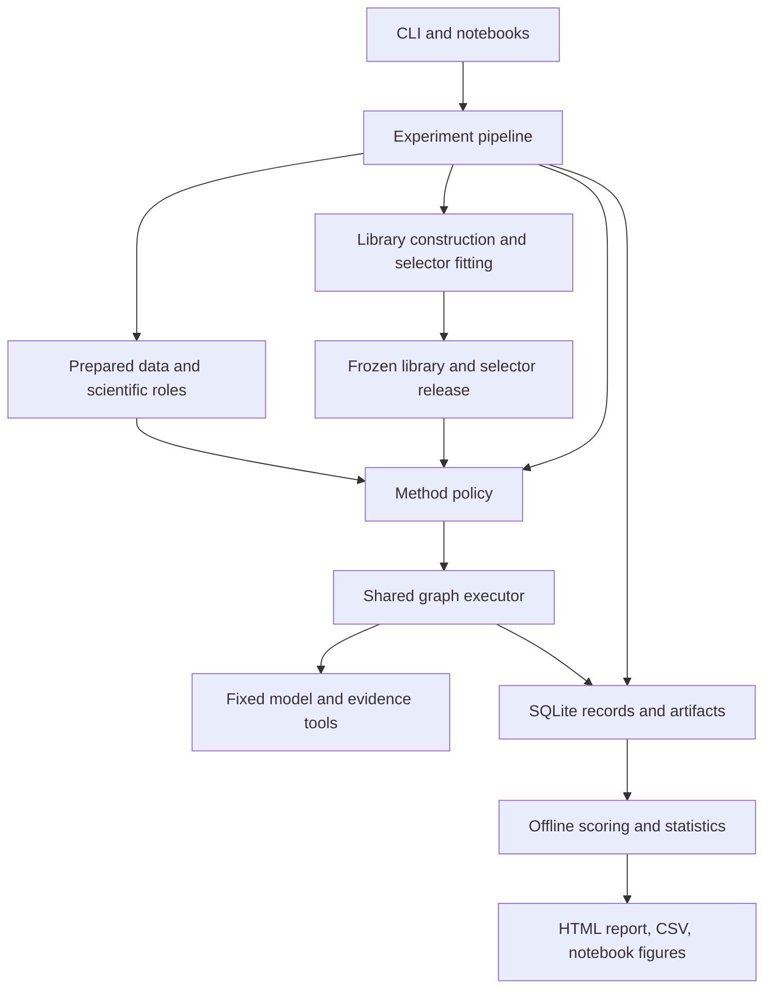

# System architecture

The target is one local Python research application. CLI commands and notebooks
share the package implementation. The package identity, typed configuration/CLI,
domain contracts, Ollama adapter, cumulative budget tracker, basic supplied-source tools and SQLite receipt store
are implemented. Full agent/workflow execution and the scientific stages below
remain planned. The optional runtime pilot makes one bounded model call.

## Component design

Development creates libraries and selectors. Final execution loads their immutable
release. Reference answers flow only to offline scoring, not to the policy,
executor, or runtime.

## Responsibilities and dependencies

| Area | Owns | Dependency boundary |
| --- | --- | --- |
| `domain/` | Tasks, graphs, outcomes, budgets, provider contracts. | Python/Pydantic; no other project area. |
| `config.py` | Validated settings and project-relative paths. | Domain/infrastructure; no fitting or scheduling. |
| `storage.py` | Transactions, records, artifact checksums, read access. | Domain/infrastructure; no workflow decisions. |
| `data/` | Acquisition, canonicalization, provenance, grouping. | Domain/config/storage. |
| `runtime/` | Model calls, encoder, tools, budget accounting. | Domain/config; integrations loaded when needed. |
| `workflows/` | Role execution, planning, graphs, library, method policies. | Domain/runtime; no gold scorer or predictor fitting. |
| `learning/` | Features, candidate labels, training, frozen prediction. | Domain/runtime/storage; online selection never fits. |
| `evaluation/` | Dataset scoring and registered statistics. | Evaluator inputs/domain; no generation or fitting. |
| `experiments/` | Stage order, jobs, experiment scopes, release verification. | Coordinates the other areas. |
| `reporting/` | Read-only queries, plots, compact reports. | Stored records/evaluation summaries; no generation. |
| CLI and notebooks | Parameters, invocation, explanation, inspection. | Public package functions. |

Policies receive an injected candidate-scoring interface; fitting remains in the
development pipeline. Avoid circular dependencies between policy execution and
training orchestration. The existing module paths are listed in
[project structure](project_structure.md).

## Core contracts

The foundation implements `TaskInput`, `EvaluationReference`, `Workflow`,
`WorkflowNode`, `RequestBudget`, `ResourceUsage`, model/provider bindings and generic
receipts. Rich role outputs, execution traces, selection decisions and frozen study
releases below are target extensions, not completed workflow functionality.

| Contract | Required contents |
| --- | --- |
| `TaskInput` | Stable task ID, question, passages/tables, source locations, observable metadata. |
| `EvaluationReference` | Answer forms and evaluator-only support/program annotations. |
| `Workflow` / `WorkflowNode` | Version, graph ID, roles, reusable instructions, dependencies, typed input/output bindings, final-answer node. |
| `AgentOutput` | Role-specific structured evidence, answer, tool request, or check verdict. |
| `RequestBudget` / `ResourceUsage` | Call, token, tool, time, repair limits and cumulative measurements with availability flags. |
| `SelectionDecision` | Candidate IDs, similarities, probabilities, token estimates, rejection reasons, selected ID. |
| `ExecutionTrace` | Request/attempt/node IDs, ordered events, evidence locations, outputs, usage, failures. |
| `FrozenRelease` | Library, encoder, transforms, predictor, calibration, thresholds, prompts/tools, data/protocol/code lineage. |

The online input object cannot contain gold annotations. Workflow templates store
procedural instructions and placeholders, not discovery answers or evidence.

## Roles and execution

| Role | Responsibility |
| --- | --- |
| Coordinator | Produce a bounded graph and invoke declared recovery. Host code performs candidate retrieval and numerical selection. |
| Retrieval | Search only the current question's passages and tables; return stable evidence references. |
| Reasoning | Combine evidence and use restricted arithmetic where needed. |
| Checking | Assess observable consistency, evidence, and output validity; return pass/fail/uncertain. |

One parameterized role runner uses versioned prompts and output schemas.
Generalization is an offline coordinator operation, not a fifth role. All model
calls use the same verified generative-model binding.

Graphs are validated before effects: known roles, valid references, acyclic edges,
no more than 12 nodes, compatible bindings, and a reachable designated answer.
Nodes execute in deterministic topological order. Independent nodes initially run
sequentially so timing and accounting remain interpretable. Every node reads fresh
current-task evidence and explicitly supplied predecessor outputs.

Tools are supplied-source search and a restricted calculator. Calculator inputs
are validated expressions or typed operations, never unrestricted Python. Search
cannot retrieve arbitrary external documents. Library retrieval selects a procedure
and is separate from evidence retrieval within a question.

## Request flow and recovery

1. Load reference-free input and validate the applicable frozen runtime/release.
2. Create one cumulative budget and the initial attempt record.
3. Invoke the chosen policy: direct agent, fixed graph, fresh planning, or reuse.
4. For reuse, retrieve common candidates and apply the frozen selection rule.
5. Validate and execute the selected graph through the shared runtime.
6. Apply the policy's declared recovery rule using only observable execution state.
7. Persist the delivered answer, attempts, resource usage, and terminal state.
8. Score the result separately against the evaluator reference.

Reuse permits at most one fresh fallback plan if no candidate qualifies or the
frozen failure rule detects an execution/checking failure. Similarity and learned
reuse share the same fallback rule. Gold correctness never triggers recovery.
Single-agent and fixed-workflow policies do not silently call a planner.

Planning, malformed-plan repair, tool loops, failed reuse, and fallback all consume
the original request allowance. Each graph is bounded separately by 12 nodes;
whole-request ceilings also constrain multiple attempts. Reserve allowances before
an effect, reconcile observed usage afterward, and record excesses explicitly.
Timeouts use remaining wall-time allowance and a monotonic clock. A blocking
provider call may not stop at an exact deadline; record this limitation honestly.

## Persistence and resume

| Location | Planned contents |
| --- | --- |
| `data/raw/` | Original source bytes and acquisition provenance. |
| `data/processed/<snapshot_id>/datasets.sqlite3` | Canonical inputs, separate references, source relations, partition assignments. |
| Snapshot manifest | Release/checksum identities, preparation version, retained/excluded counts. |
| `data/cache/` | Recomputable encoder vectors and indexes keyed by content and binding hashes. |
| `runs/<run_id>/results.sqlite3` | Authoritative configuration, jobs, attempts, events, decisions, scores, usage, artifacts. |
| `runs/<run_id>/metrics.csv` | Regenerable compact metrics. |
| `runs/<run_id>/report.html` | Regenerable summary, figures, progress, selected traces. |
| `artifacts/` | Deliberate frozen-release exports. |

Store generated workflows, transformations, predictors, calibration, and stage
receipts as checksummed database artifacts. A run lock prevents concurrent writers;
it is an operational file. Optional publication exports are deliberate, not
uncontrolled per-task outputs.

Logical records include runs, scopes/folds, stage jobs, requests, attempts, node/tool
events, candidate decisions, scores, resources, and artifacts. Stable keys bind
method, task, workflow, versions, and repetition. Database schema details are
implemented with the storage work package; these are logical ownership contracts.

Write intent before external calls and results transactionally afterward. A crash
between them can leave an unknown effect with possible resource expenditure.
Resume completed jobs without replaying known effects. Preserve unknown attempts;
any retry gets a new identity and explicit accounting. Do not claim exactly-once
external generation or replace unavailable usage with zero.

## Stage and release boundaries

The existing plan exposes nine pending stages:

| Stage | Target output |
| --- | --- |
| `prepare_data` | Dataset snapshot, partitions, scorer/preparation receipts. |
| `baseline_pilot` | Representative measured baselines and feasible runtime limits. |
| `discover_library` | Discovery, generalization, independent validation, frozen library. |
| `collect_candidates` | Matched task/workflow outcomes for permitted development roles. |
| `prepare_features` | Audited features and fitting-only transformations. |
| `train_selectors` | Predictors, calibration, thresholds, token estimates. |
| `development_pilot` | Integrated-policy validation and workload estimate. |
| `final_evaluation` | Protected execution from a verified immutable release. |
| `analyze_results` | Read-only statistics, plots, report, and exports. |

Release freezing is a required gate between the development pilot and final
execution; it is not currently an implemented command. Final execution refuses
mutable libraries, missing bindings, incompatible hashes, or fitting operations.
Transfer folds use the same stages with different permitted development scopes.

Long stages show phase/subphase, scope/fold, current method/task/role,
planned/completed/failed/unknown counts, elapsed time, and available usage. Training
shows fitting, validation, calibration, and threshold selection separately. Cached
records are labeled as reused; they are not newly measured live executions.
